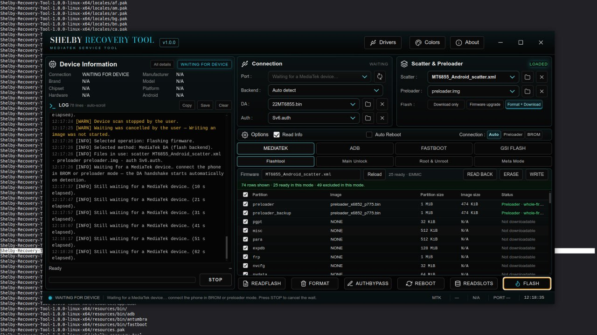

<div align="center">

# Shelby Recovery Tool - Linux Trial



**Version:** 1.0.0 (Trial / Testing Build)
**Platform:** Linux x64

</div>

A MediaTek-focused flashing and recovery utility — partition read/write, firmware flashing, scatter/preloader handling, and device detection via an SP Flash Tool–style backend, with Flashtool, ADB, Fastboot, and GSI Flash modes.

> ⚠️ **This is a trial/testing build.** Expect bugs. Please report issues (see below) so they can be fixed quickly.

## Features
- MediaTek flash / read-back / erase via DA (Download Agent)
- Scatter file + preloader support, with preloader backup detection
- Auth file support (`SvX.auth`)
- Partition-level read/write with size and status display
- Auto device detection (BROM / Preloader modes)
- Multiple backend modes: Flashtool, ADB, Fastboot, GSI Flash, Meta Mode
- Built-in driver manager, theming ("Colors"), and live log console with auto-scroll

## Setup

### Requirements
- Any modern 64-bit Linux desktop distribution (x86-64)
- MediaTek USB drivers (see the in-app **Drivers** menu)
- A valid scatter file + preloader/DA matching your device's exact chipset

### Installation
```bash
tar -xf Shelby-Recovery-Tool-1.0.0-linux-x64.tar.xz
cd Shelby-Recovery-Tool-1.0.0-linux-x64
./Shelby-Recovery-Tool
```

### Usage
1. Load your scatter file and preloader under **Scatter & Preloader**.
2. Select the DA and Auth files under **Connection**.
3. Pick your operation (Flash, Read Back, Erase, Auth Bypass, etc.).
4. Connect your device in BROM or Preloader mode — detection is automatic.
5. Watch the **LOG** panel for status; `STOP` cancels an in-progress wait or operation.

## Reporting Bugs
This is an early test build — if you hit an error or unexpected behavior:
- Open an [Issue](../../issues) and attach your log output (copy from the in-app **LOG** panel, or use **Save**)
- Include your device's chipset/platform, the operation attempted, and the scatter/DA/auth files used

## Developers
- **Main Developer:** Dev_Null10
- **Co-Developer:** Shelby

## License
See [LICENSE](LICENSE).

## Disclaimer
Use at your own risk. Flashing or erasing partitions can brick a device if done with scatter/preloader/DA files that don't match your exact chipset and model. Always keep a copy of `preloader_backup` and verify your files before writing.
